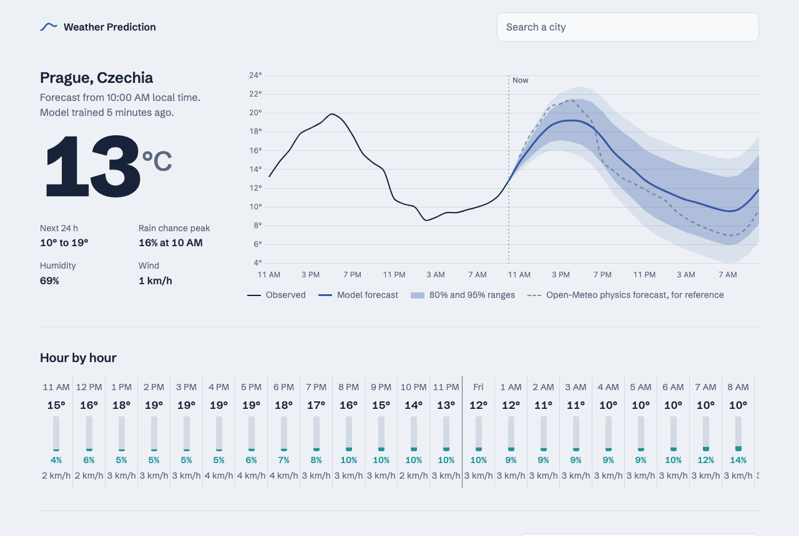
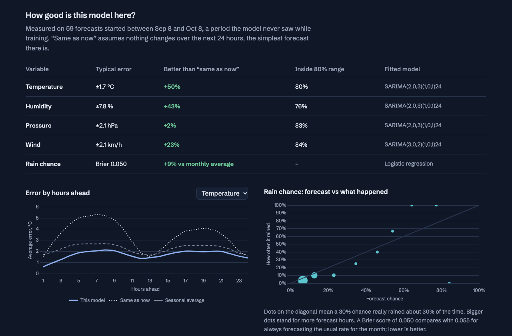
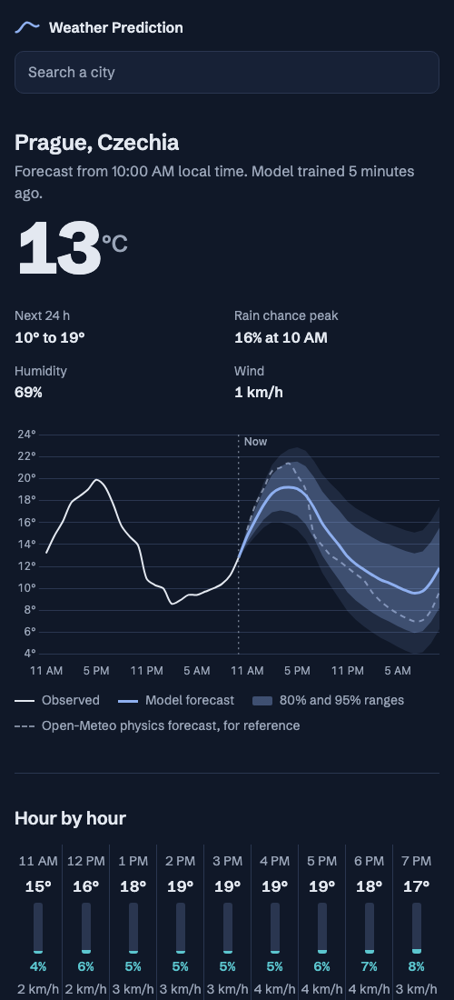
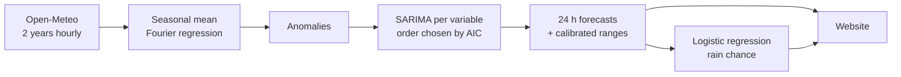

<div align="center">

# 〰️ Weather Prediction

**24-hour weather forecasts from pure statistics.**<br>
A seasonal ARIMA model trained on two years of local history, for any city on Earth, with honest uncertainty.




</div>

---

## Contents

- [What it does](#what-it-does)
- [Quick start](#quick-start)
- [How the model works](#how-the-model-works)
- [How good is it?](#how-good-is-it)
- [API](#api)
- [Project structure](#project-structure)
- [Design notes](#design-notes)
- [Data & credits](#data--credits)

## What it does

Search for a city. The server downloads two years of hourly weather for that spot, fits a statistical
model in about 8 seconds, and forecasts the next 24 hours:

| | Forecast | How |
|---|---|---|
| 🌡️ | **Temperature** | Seasonal mean + SARIMA |
| 💧 | **Humidity** | Seasonal mean + SARIMA on a logit scale (stays within 0–100%) |
| 🧭 | **Pressure** | Seasonal mean + SARIMA |
| 🌬️ | **Wind speed** | Seasonal mean + SARIMA on a √ scale (never negative) |
| ☔ | **Rain chance** | Logistic regression on the forecasts above |

Every forecast comes with **80% and 95% ranges**. The site also shows **how the model did over the last
30 days**, a period it never saw during training. Open-Meteo's physics-based forecast is drawn as a dashed line,
so you can see how simple statistics compare with a full weather model.

<table>
  <tr>
    <td width="68%"></td>
    <td width="32%"></td>
  </tr>
  <tr>
    <td align="center"><sub>Every forecast is scored against simple baselines</sub></td>
    <td align="center"><sub>Responsive, light and dark mode</sub></td>
  </tr>
</table>

## Quick start

```sh
git clone https://github.com/chlibekp/weather-prediction.git
cd weather-prediction
npm install
npm start
```

Open **http://localhost:3000** and pick a city.

| Variable | Default | Meaning |
|---|---|---|
| `PORT` | `3000` | HTTP port |
| `CACHE_DIR` | `data/cache` | Where trained models are stored |

```sh
npm test    # 17 tests: math, model recovery on simulated data, API routes
```

> [!NOTE]
> The first visit to a place trains a new model (~8 s, in a worker thread so the server stays responsive).
> Models are cached per 0.1° grid cell (about 10 km) and retrained after 24 hours. No API key is needed.

## How the model works



### 1. What is normal: the seasonal mean

Each variable is first split into what's normal for that hour and season, plus today's departure from
normal. The normal part is an ordinary least-squares fit on Fourier terms:

$$
\mu(t) = \beta_0 + \sum_{k=1}^{2} \big(a_k \sin k\omega_y t + b_k \cos k\omega_y t\big)
       + \sum_{k=1}^{3} \big(c_k \sin k\omega_d t + d_k \cos k\omega_d t\big)
       + \text{(daily × yearly interaction)}
$$

The interaction terms let the daily cycle be bigger in summer than in winter.

### 2. What is different today: SARIMA

The anomalies $z_t$ follow a multiplicative seasonal ARIMA with a 24-hour season:

$$
\phi(B)\,\Phi(B^{24})\,(1-B)^d\,(z_t-\mu) = \theta(B)\,\Theta(B^{24})\,\varepsilon_t
$$

- **Order selection:** every combination of $p, q \le 3$ and $P, Q \le 1$ is screened with
  **Hannan–Rissanen** regressions (a long AR model gives residual proxies, then OLS). Each candidate is
  scored by AIC.
- **Estimation:** the best candidates are refined by minimizing the **conditional sum of squares** with
  Nelder–Mead. A step-down (Levinson) test keeps every polynomial stationary and invertible.
- **Differencing:** $d \in \{0, 1\}$ is picked by actual 24-hour forecast error on a 14-day validation window.

### 3. How sure: calibrated ranges

The forecast variance comes from the model's ψ-weights, $\operatorname{Var}(\hat z_{t+h}) = \sigma^2 \sum_{j<h} \psi_j^2$.
Theory alone tends to be over- or under-confident, so each lead hour gets a scale factor. The factor is
set so that 80% of forecast errors across the training year fall inside the 80% range.

### 4. Will it rain: logistic regression

The SARIMA forecasts feed a ridge-regularized **logistic regression**. Its inputs are forecast humidity,
3-hour pressure tendency, wind, temperature anomaly, time of day, season, and whether it was raining
when the forecast was made (fading with lead time). It is trained on the model's own forecasts from
about 1,800 past origins, so it learns how much to trust them.

> All of the math (Cholesky solves, Nelder–Mead, IRLS, polynomial algebra) is hand-written
> JavaScript in [`src/math`](src/math) and [`src/model`](src/model). The only runtime dependency is Express.

## How good is it?

Each model is scored on its **last 30 days of data, held out from training**: 59 forecast runs × 24 hours.
It is compared with two baselines: *persistence* (nothing changes) and *climatology* (the seasonal average).

<div align="center">

**Prague, October 2026**

| Variable | Typical error | Better than persistence | Inside 80% range |
|---|---:|---:|---:|
| Temperature | ±1.7 °C | **+50%** | 80% |
| Humidity | ±7.8 % | **+43%** | 76% |
| Wind | ±2.1 km/h | **+23%** | 84% |
| Pressure | ±2.1 hPa | +2% | 83% |
| Rain chance | Brier 0.050 | +9% vs monthly average | — |

</div>

Pressure barely beats persistence: over one day it behaves almost like a random walk, so "same as now"
is a strong baseline. The site shows this per city instead of hiding it.

## API

<details>
<summary><code>GET /api/geocode?q=Brno</code>: city search</summary>

```json
{
  "results": [
    { "name": "Brno", "admin1": "South Moravian", "country": "Czechia",
      "latitude": 49.195, "longitude": 16.608, "timezone": "Europe/Prague" }
  ]
}
```
</details>

<details>
<summary><code>GET /api/forecast?lat=49.19&lon=16.61</code>: forecast, model info and backtest</summary>

```jsonc
{
  "origin": 1791446400000,               // last observed hour (UTC ms)
  "times": [/* 24 forecast hours */],
  "forecast": {
    "temperature": { "mean": [], "lo80": [], "hi80": [], "lo95": [], "hi95": [] },
    "humidity": {}, "pressure": {}, "windSpeed": {},
    "rainProbability": [/* 0..1 */]
  },
  "nwp": {/* Open-Meteo physics forecast for the same hours */},
  "observed": {/* last 24 hours */},
  "model": { "trainedAt": 0, "stale": false, "variables": { "temperature": { "order": "SARIMA(2,0,3)(1,0,1)24" } } },
  "metrics": {/* backtest: MAE by lead hour, skill, coverage, rain Brier & reliability */}
}
```

Errors: `400` for invalid coordinates, `502` when Open-Meteo is unreachable. If retraining fails,
yesterday's model is served and `model.stale` is set to `true`.
</details>

## Project structure

```
src/
├── math/            linalg (Cholesky, streaming normal equations), Nelder–Mead, stats
├── model/
│   ├── seasonal.js      Fourier seasonal mean
│   ├── sarima.js        SARIMA: Hannan–Rissanen, CSS fit, ψ-weights, forecasting
│   ├── variableModel.js seasonal mean + SARIMA + interval calibration per variable
│   ├── rain.js          logistic regression (damped Newton / IRLS)
│   └── forecaster.js    training pipeline, backtest, 24 h forecast
├── data/            Open-Meteo client, hourly series builder with gap masking
├── service.js       model cache, training dedupe, forecast payload
├── train-worker.js  training off the main thread
├── app.js           Express routes
└── server.js        entry point
public/              single-page site: vanilla JS + Chart.js
test/                node:test suites
```

## Design notes

A few things that weren't obvious and are worth knowing before you change the model:

- **History and live data must come from the same source.** The first version trained on the ERA5
  reanalysis archive and forecast from the live forecast API. ERA5 reads 2–4% humidity and about
  2 km/h wind differently, so the model saw a fake anomaly at every forecast start, and humidity
  forecasts drifted to 100%. History now comes from Open-Meteo's *historical forecast* API, which
  matches the live data exactly.
- **Multiplicative SARIMA needs its cross-lags during screening.** $(1-\phi B)(1-\Phi B^{24})$ also
  includes a lag-25 term. Without it in the Hannan–Rissanen regressions, AIC favours bloated models.
- **AIC is only comparable over the same sample.** Every candidate is scored over a fixed burn-in.
- **Calibrate ranges over a long window.** Calibration on two weeks fit that fortnight's weather and gave
  62–70% coverage on the holdout. Calibrating over a year brought it close to 80%.
- **Bounded variables get bounded transforms.** Clipping a forecast at 100% humidity hides bad behavior.
  A softened logit keeps both the forecast and its ranges inside 0–100%.

## Data & credits

Weather data and geocoding come from [Open-Meteo](https://open-meteo.com/), licensed under
[CC BY 4.0](https://creativecommons.org/licenses/by/4.0/). Charts use [Chart.js](https://www.chartjs.org/)
and the typeface is [Schibsted Grotesk](https://fonts.google.com/specimen/Schibsted+Grotesk).
